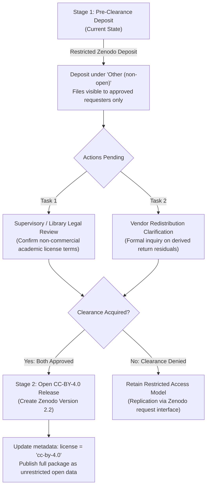

# MoTrans-15: Open Release Plan & Dual Licensing Framework

This document outlines the operational roadmap for managing open versus restricted research assets in **MoTrans-15**, detailing the formal legal and technical conditions required to transition the dataset to an open **Creative Commons Attribution 4.0 International (CC-BY-4.0)** license.

---

## 1. Asset Classification: Open vs. Restricted Tiers

To comply with primary provider intellectual property terms while maximizing scientific utility, the MoTrans-15 project partitions assets into two distinct tiers:

### Tier A: Fully Open Assets (Permissive Open Access)
These assets contain zero proprietary financial index feeds and can be distributed immediately under permissive open terms:

| Asset Category | Specific Files | Stated Provider License | Target Open License |
| :--- | :--- | :--- | :--- |
| **Pipeline & Analysis Code** | `src/`, `tests/`, `tasks.py`, `conftest.py`, `pytest.ini` | Maintainer Copyright (2026) | **MIT License** |
| **Monetary Policy Surprises** | `shocks.parquet` (pre-processed dates, decisions, size in bp, HF surprises) | US Fed (Public Domain), ECB (EA-MPD Open Academic), BIS (Public Policy) | **CC-BY-4.0** |
| **Research Documentation** | Data dictionary, limitations, preregistration, freeze certificates, audit logs | Maintainer Copyright (2026) | **CC-BY-4.0** |
| **CV Fold Configurations** | `folds.csv` (origin dates, partition boundaries, embargo windows) | Maintainer Copyright (2026) | **CC-BY-4.0** |
| **Verification Reports** | `split_counts.csv`, `fold_counts.csv`, `row_membership.csv`, `leakage_audit.csv` | Generated outputs | **CC-BY-4.0** |

### Tier B: Restricted Research Assets (Pre-Clearance Restricted Access)
These assets incorporate continuous log return windows derived from commercial financial exchange price feeds:

| Asset Category | Specific Files | Current Distribution Terms | Primary Providers |
| :--- | :--- | :--- | :--- |
| **Analysis Tables** | `analysis_tier1.parquet`, `analysis_tier2_primary.parquet`, `secondary_holds.parquet`, `sensitivity_macro_revision.parquet` | Custom Non-Open Research License (`LICENSE`) | Yahoo Finance, B3, Moscow Exchange, CSI, NSE |
| **Panel Returns** | `panel_returns_only.parquet` (continuous log returns without starting levels) | Custom Non-Open Research License (`LICENSE`) | Commercial exchange feeds across 15 economies |

---

## 2. Status of License Review and Vendor Clearance

As recorded in `zenodo_release_config.py` and `docs/PROJECT_SUMMARY.md`:
- **Institutional / Supervisory Review**: `LICENCE_REVIEW_DONE = NO`. Formal review by university legal counsel or library scholarly communications office is pending.
- **Vendor Redistribution Clearance**: `VENDOR_CLEARANCE = NOT_CLEARED`. Formal written permission to redistribute derived cumulative return series has not been executed with primary index providers.

### Why Access is Currently Restricted
Financial index return series are mathematically derived from proprietary commercial closing prices. Although absolute price levels (`level_local`, `close`, `price`) were strictly purged to protect vendor copyright, conservative IP law dictates that derived return series remain restricted until written redistribution clearance is established.

---

## 3. Two-Stage Roadmap to Open Release (CC-BY-4.0)

### Action Items for Stage 2 Transition
1. **Submit Formal Query to Exchange Data Licensing Offices**:
   - Issue written inquiry to major index licensors (S&P Dow Jones, STOXX, FTSE Russell, Nikkei Inc.): *"Does academic distribution of de-identified, un-anchored continuous log return residuals around central bank announcements constitute copyright infringement of underlying closing price feeds?"*
2. **Execute Supervisor / Library Clearance**:
   - Present `LICENCE_AND_PROVENANCE.md` to university copyright librarians for formal determination of fair dealing / academic research exemption.
3. **Record Findings in `LICENCE_CLEARANCE.txt`**:
   - Once formal determinations are signed, log findings into `LICENCE_CLEARANCE.txt`, update `zenodo_release_config.py` (`DATA_LICENSE = "CC-BY-4.0"`), and release an updated version on Zenodo.

