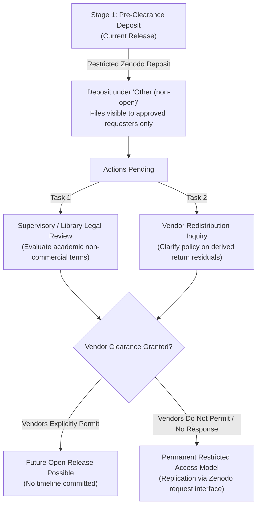

# MoTrans-15: Open Release Plan & Dual Licensing Framework

**Date**: 2026-11-04  
**Status**: ACTIVE WORKING DRAFT  
**Scope**: Licensing and Governance Roadmap for Research Assets  
**Core Rule**: Authors' original contributions are CC-BY-4.0 and MIT; derived return tables are restricted and subject to vendor terms. Any future open release of derived return tables is possible only if vendors permit, with no timeline.

---

## 1. Asset Classification: Open vs. Restricted Tiers

To comply with primary financial market vendor intellectual property terms while maximizing open science reproducibility, the MoTrans-15 project partitions all research assets into two strictly segregated tiers:

### Tier A: Maintainer Original Contributions (Permissive Open Terms)
These assets contain exclusively maintainer-authored software, documentation, verified shock series, and metadata, containing zero proprietary price feeds. They are distributed under permissive open licenses:

| Asset Category | Specific Components | License | Terms & Attribution |
| :--- | :--- | :--- | :--- |
| **Code & Pipeline** | `src/`, `tests/`, `tasks.py`, `conftest.py`, `pytest.ini` | **MIT License** | Open permissive software license; free for academic and commercial reuse with attribution. |
| **Monetary Surprise Series** | `shocks.parquet` (decision dates, policy actions, size in bp, HFI shocks) | **CC-BY-4.0** | Creative Commons Attribution 4.0; public-domain Fed and open EA-MPD central bank shocks. |
| **Research Documentation** | Data dictionaries, limitations, pre-registration logs, audit certificates | **CC-BY-4.0** | Creative Commons Attribution 4.0. |
| **Evaluation Partitions** | `folds.csv` (origin dates, embargo boundaries, fold memberships) | **CC-BY-4.0** | Creative Commons Attribution 4.0. |
| **Verification Reports** | `split_counts.csv`, `fold_counts.csv`, `row_membership.csv`, audit logs | **CC-BY-4.0** | Creative Commons Attribution 4.0. |

### Tier B: Restricted Research Assets (Pre-Clearance Restricted Access)
These assets incorporate continuous log return windows mathematically derived from commercial financial exchange price feeds:

| Asset Category | Specific Tables | Current Distribution Terms | Primary Providers |
| :--- | :--- | :--- | :--- |
| **Core Analysis Tables** | `analysis_tier1.parquet`, `analysis_tier2_primary.parquet`, `secondary_holds.parquet`, `sensitivity_macro_revision.parquet` | Custom Non-Open Research License (`LICENSE`) | Yahoo Finance, B3, Moscow Exchange, CSI, NSE |
| **Panel Returns** | `panel_returns_only.parquet` (continuous log returns without starting levels) | Custom Non-Open Research License (`LICENSE`) | Commercial exchange feeds across 15 economies |

---

## 2. Status of License Review and Vendor Clearance

As recorded in `zenodo_release_config.py` and `docs/PROJECT_SUMMARY.md`:
- **Institutional / Supervisory Review**: `LICENCE_REVIEW_DONE = NO`. Formal review by university legal counsel or library scholarly communications office is pending.
- **Vendor Redistribution Clearance**: `VENDOR_CLEARANCE = NOT_CLEARED`. Formal written permission to redistribute derived cumulative return series has not been executed with primary index providers.

### Why Derived Return Tables are Restricted
Financial index return series are mathematically derived from proprietary commercial closing prices. Although absolute price levels (`level_local`, `close`, `price`) were strictly purged to protect vendor copyright, conservative intellectual property law dictates that derived return tables remain restricted under vendor redistribution terms.

**No file or release in this project promises a future open CC-BY release of derived returns.** Any future open release of derived returns is possible **only if commercial vendors explicitly permit, with no timeline**.

---

## 3. Governance and Inquiries Framework



### Action Items for Vendor Clarification
1. **Formal Query to Exchange Data Licensing Offices**:
   - Issue written inquiry to major index licensors (S&P Dow Jones, STOXX, FTSE Russell, Nikkei Inc.): *"Does academic distribution of de-identified, un-anchored continuous log return residuals around central bank announcements constitute copyright infringement of underlying closing price feeds?"*
2. **Supervisory / Library Legal Clearance**:
   - Present `LICENCE_AND_PROVENANCE.md` to university copyright librarians for formal determination of fair dealing / academic research exemption.
3. **Recording Outcomes**:
   - If and only if written vendor clearance is acquired, findings will be recorded in `LICENCE_CLEARANCE.txt`. Until that point, all derived return tables remain restricted with no timeline for open release.

---

## 4. Open Release Components vs. Restricted Assets Matrix

To ensure absolute clarity regarding what can be freely released to the public under open licenses versus what must remain restricted on Zenodo:

| Component | Open CC-BY / MIT Release | Restricted Access Deposit | Justification & Distribution Mechanism |
| :--- | :---: | :---: | :--- |
| **Data Processing Pipeline** (`src/`, `tests/`, `tasks.py`) | **YES (MIT)** | Included | Fully open permissive source code. |
| **Dataset Schemas & Column Dictionaries** | **YES (CC-BY-4.0)** | Included | Descriptive scientific documentation. |
| **Splits & Partitions** (`splits.csv`, `folds.csv`) | **YES (CC-BY-4.0)** | Included | Origin dates, fold assignments, embargo flags; zero price data. |
| **Cryptographic Checksums & Manifests** | **YES (CC-BY-4.0)** | Included | SHA-256 hashes for data integrity verification. |
| **Monetary Policy Shocks** (`shocks.parquet`) | **YES (CC-BY-4.0)** | Included | Public-domain Fed surprises and open EA-MPD central bank shocks. |
| **Vendor Download Rebuilding Script** | **YES (MIT)** | Included | Python scripts enabling any user with their own institutional vendor license to rebuild return panels locally. |
| **Derived Cumulative Returns** (`clr_*` in analysis tables and `panel_returns_only.parquet`) | **NO** | **RESTRICTED ONLY** | Continuous log return residuals derived from commercial exchange closing prices. Retained under restricted access pending vendor clearance. |

---

## 5. Vendor Permission Request Template & Current Status

### 5.1 Official Vendor Redistribution Status
> **STATUS NOTICE**:  
> **NO VENDOR REDISTRIBUTION PERMISSION HAS BEEN GRANTED.**  
> To date, neither S&P Dow Jones, STOXX, FTSE Russell, Nikkei Inc., B3, nor any other primary index provider has granted permission to redistribute derived cumulative return panels under an open license.  
> Derived return tables (`analysis_tier1.parquet`, `analysis_tier2_primary.parquet`, `secondary_holds.parquet`, `sensitivity_macro_revision.parquet`, and `panel_returns_only.parquet`) **must remain strictly restricted** under Zenodo's restricted access interface. No file, publication, or package in this project promises an open release.

### 5.2 Formal Vendor Permission Request Template
The following formal inquiry template is designated for institutional scholarly communication officers and principal investigators to submit to commercial index licensors:

```text
SUBJECT: Academic Research Inquiry Regarding Derived Index Return Residuals (MoTrans-15 Benchmark)

TO: Index Licensing & Market Data Redistribution Office
    [Licensor Name: e.g., S&P Dow Jones Indices / STOXX / FTSE Russell / Nikkei Inc.]

FROM: [Principal Investigator Name & Academic Affiliation]
      [University Research Department / Scholarly Communications Office]

DATE: [Date]

Dear Licensing Team,

We are conducting an academic, non-commercial empirical finance research project titled "MoTrans-15: Monetary policy surprises and equity-index responses for the largest economies, 2010-2025," targeted for publication in an academic journal (Scientific Data / Nature Portfolio).

As part of scientific reproducibility standards, we wish to clarify your institution's policy regarding the deposit and academic redistribution of mathematical residuals derived from historical daily index closing prices:

1. Scope of Data:
   - Our research dataset purges all nominal price index levels, closing levels, and absolute index prices (level_local = NULL).
   - The data contain exclusively short-window cumulative log return differences (e.g., ln(P_{t+W}) - ln(P_{t-1})) across 1 to 60 trading days centered around central bank monetary policy announcements.
   - It is impossible to reconstruct absolute price levels from these percentage return residuals without possessing an external, authorized baseline price level.

2. Requested Determination:
   Does your institution consider the non-commercial academic distribution of un-anchored, cumulative log return residuals around discrete event dates to be:
   (a) Subject to commercial redistribution licensing fees and restrictions; OR
   (b) Permissible for non-commercial academic research replication under a scholarly research data sharing exemption?

3. Proposed Handling:
   - Until explicit written confirmation is received, all tables containing derived returns are deposited under Zenodo Restricted Access (requiring individual institutional researcher verification).
   - No public open distribution (such as CC-BY) will occur without your explicit, written consent.

We would be deeply grateful for your formal guidance on this matter.

Sincerely,

[Principal Investigator Name & Title]
[Institutional Contact & Research Office Information]
```
