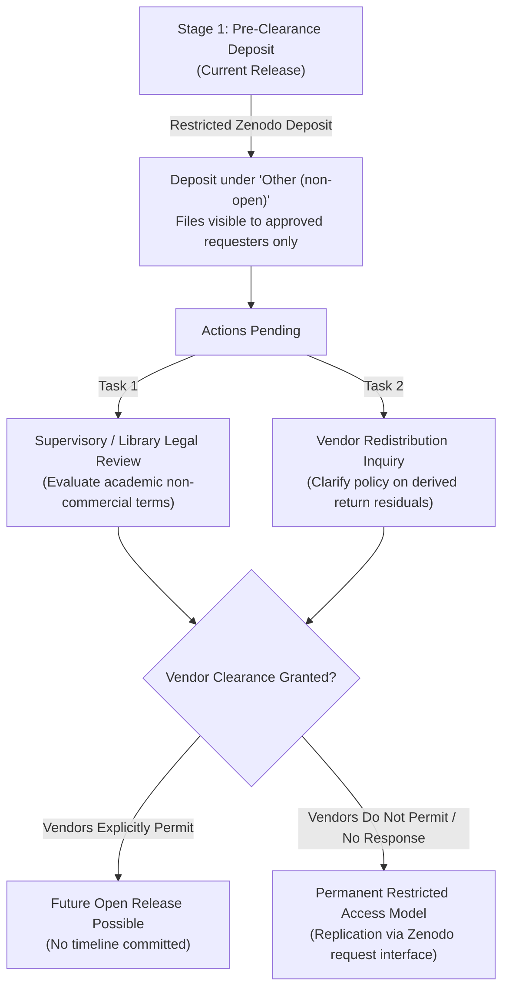

# MoTrans-15: Open Release Plan & Dual Licensing Framework

**Date**: 2026-11-04  
**Status**: ACTIVE WORKING DRAFT  
**Scope**: Licensing and Governance Roadmap for Research Assets  
**Core Rule**: Authors' original contributions are CC-BY-4.0 and MIT; derived return tables are restricted and subject to vendor terms. Any future open release of derived return tables is possible only if vendors permit, with no timeline.

---

## 1. Asset Classification: Open vs. Restricted Tiers

To comply with primary financial market vendor intellectual property terms while maximizing open science reproducibility, the MoTrans-15 project partitions all research assets into two strictly segregated tiers:

### Tier A: Maintainer Original Contributions (Permissive Open Terms)
These assets contain exclusively maintainer-authored software, documentation, verified shock series, and metadata, containing zero proprietary price feeds. They are distributed under permissive open licenses:

| Asset Category | Specific Components | License | Terms & Attribution |
| :--- | :--- | :--- | :--- |
| **Code & Pipeline** | `src/`, `tests/`, `tasks.py`, `conftest.py`, `pytest.ini` | **MIT License** | Open permissive software license; free for academic and commercial reuse with attribution. |
| **Monetary Surprise Series** | `shocks.parquet` (decision dates, policy actions, size in bp, HFI shocks) | **CC-BY-4.0** | Creative Commons Attribution 4.0; public-domain Fed and open EA-MPD central bank shocks. |
| **Research Documentation** | Data dictionaries, limitations, pre-registration logs, audit certificates | **CC-BY-4.0** | Creative Commons Attribution 4.0. |
| **Evaluation Partitions** | `folds.csv` (origin dates, embargo boundaries, fold memberships) | **CC-BY-4.0** | Creative Commons Attribution 4.0. |
| **Verification Reports** | `split_counts.csv`, `fold_counts.csv`, `row_membership.csv`, audit logs | **CC-BY-4.0** | Creative Commons Attribution 4.0. |

### Tier B: Restricted Research Assets (Pre-Clearance Restricted Access)
These assets incorporate continuous log return windows mathematically derived from commercial financial exchange price feeds:

| Asset Category | Specific Tables | Current Distribution Terms | Primary Providers |
| :--- | :--- | :--- | :--- |
| **Core Analysis Tables** | `analysis_tier1.parquet`, `analysis_tier2_primary.parquet`, `secondary_holds.parquet`, `sensitivity_macro_revision.parquet` | Custom Non-Open Research License (`LICENSE`) | Yahoo Finance, B3, Moscow Exchange, CSI, NSE |
| **Panel Returns** | `panel_returns_only.parquet` (continuous log returns without starting levels) | Custom Non-Open Research License (`LICENSE`) | Commercial exchange feeds across 15 economies |

---

## 2. Status of License Review and Vendor Clearance

As recorded in `zenodo_release_config.py` and `docs/PROJECT_SUMMARY.md`:
- **Institutional / Supervisory Review**: `LICENCE_REVIEW_DONE = NO`. Formal review by university legal counsel or library scholarly communications office is pending.
- **Vendor Redistribution Clearance**: `VENDOR_CLEARANCE = NOT_CLEARED`. Formal written permission to redistribute derived cumulative return series has not been executed with primary index providers.

### Why Derived Return Tables are Restricted
Financial index return series are mathematically derived from proprietary commercial closing prices. Although absolute price levels (`level_local`, `close`, `price`) were strictly purged to protect vendor copyright, conservative intellectual property law dictates that derived return tables remain restricted under vendor redistribution terms.

**No file or release in this project promises a future open CC-BY release of derived returns.** Any future open release of derived returns is possible **only if commercial vendors explicitly permit, with no timeline**.

---

## 3. Governance and Inquiries Framework

### Action Items for Vendor Clarification
1. **Formal Query to Exchange Data Licensing Offices**:
   - Issue written inquiry to major index licensors (S&P Dow Jones, STOXX, FTSE Russell, Nikkei Inc.): *"Does academic distribution of de-identified, un-anchored continuous log return residuals around central bank announcements constitute copyright infringement of underlying closing price feeds?"*
2. **Supervisory / Library Legal Clearance**:
   - Present `LICENCE_AND_PROVENANCE.md` to university copyright librarians for formal determination of fair dealing / academic research exemption.
3. **Recording Outcomes**:
   - If and only if written vendor clearance is acquired, findings will be recorded in `LICENCE_CLEARANCE.txt`. Until that point, all derived return tables remain restricted with no timeline for open release.
